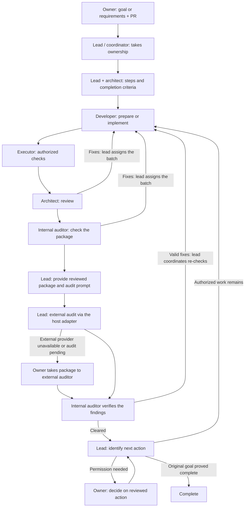

# Coordinated PR team: from requirements to completion

The owner gives the requirements to the existing lead in the main session. The lead owns continuity; the architect defines the technical steps with it. `/pr-team` starts from an existing PR. This drawing describes the instructed workflow, not evidence of a completed run.

The lead maintains one plan throughout. Review-round limits still apply; unresolved blockers stay visible. An external audit, a merge or a coding milestone does not establish original-goal completion. The lead uses existing permissions and brings the owner only a concrete reviewed decision when the next action exceeds them.
