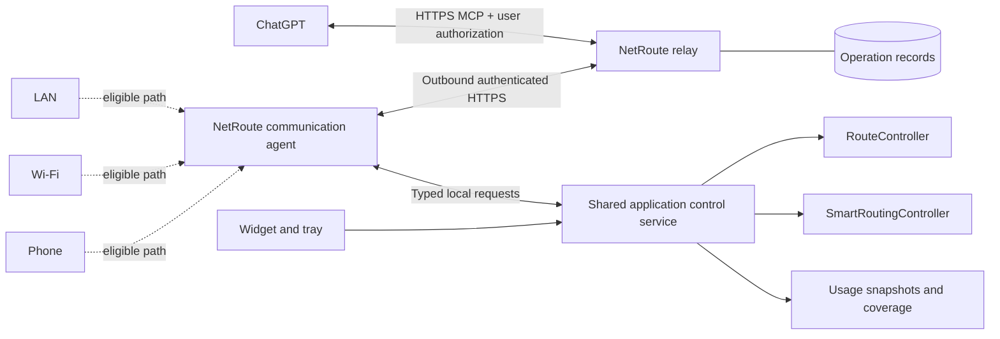

# NetRoute MCP control and resilient communication — Design

**Date:** 2026-11-03 (Asia/Beirut)

**Status:** Proposed design; implementation and live network validation have not started.

**Repository baseline:** `fdd076b`, NetRoute Widget 6.0.0, .NET 10 / Windows.

**Owner request:** Use ChatGPT to inspect internet health, compare LAN/phone usage, select a connection, and enable or disable Smart routing. Communication with NetRoute must recover through whichever configured connection works.

## 1. The behavior being built

The owner clarified that automatic fallback is for **communication with NetRoute itself**. If LAN cannot reach the command service and phone can, requests and results must travel through phone without requiring another command to repair the communication channel.

Examples:

- “What is my internet status?” reports each configured connection, the selected profile, the actual default internet path, Smart state, and the connection carrying commands.
- “Switch to phone and disable Smart” changes the requested settings, verifies the resulting state, and reports the result even if the change interrupts the command connection.
- “How much have I used this month through LAN versus phone?” returns recorded upload/download totals for the current calendar month, with coverage and measurement limitations.
- LAN fails before a request arrives: NetRoute independently reconnects its command channel through another working connection, then receives the request there.
- LAN fails after a command executes: the result survives the disconnect and can be retrieved after reconnection. The command is not blindly executed again.

“Working” means able to complete an authenticated HTTPS exchange with the command service. Being plugged in, having a gateway, or answering a public TCP probe is insufficient evidence of command-service reachability.

The promise is **automatic reconnection and recoverable command results**, not uninterrupted sockets or a guaranteed answer within every ChatGPT timeout. No live answer is possible while all usable paths are down, the PC is asleep/off, NetRoute is stopped, or the remote service is unavailable. Recovery of NetRoute's channel does not itself repair the ChatGPT browser/app's internet connection on the same PC.

### Required versus proposed choices

The requested capabilities and communication-only fallback are owner requirements. The relay architecture, .NET implementation, failover timings, tool names, collection policy, retention, and initial limits below are engineering proposals. They have not been individually approved by the owner.

## 2. Scope and boundaries

First release:

- One owner and one paired Windows PC; every request still includes an authorized `device_id` to avoid an ambiguous “current computer.”
- Remote ChatGPT access through an authenticated Streamable HTTP MCP endpoint.
- Connection discovery for the configured LAN, Wi-Fi, and phone slots; use stable IDs rather than localized names or adapter indexes in the tool contract.
- Status/configuration reads, retained usage queries, setting the preferred connection and Smart enabled state, and retrieving operation results.
- Automatic recovery of command traffic across configured physical adapters, including while Smart is off or paused and while ordinary traffic uses another path.
- Recording demand while MCP is enabled, independent of whether the Usage window is open; honest historical coverage reporting.
- Local enable/disable, pairing/revocation, communication state, and a record of remote setting changes.

Out of scope:

- A new policy for moving all PC traffic on failure. Existing auto-heal continues to follow its current setting; MCP recovery does not toggle it or replace its policy.
- Full Wi-Fi Smart routing or Wi-Fi usage attribution. Expose unsupported values explicitly rather than booking Wi-Fi bytes as LAN/phone.
- Arbitrary extra network slots beyond the three currently supported, router-firmware/NAT configuration, arbitrary commands, arbitrary file access, rule-list editing, and remote adapter assignment.
- Unsolicited ChatGPT messages, a public plugin-store listing, multi-owner fleet management, and high availability across multiple relay regions.
- A Windows service running before login or after the widget quits. The first version runs while the existing widget runs; “close card” and “quit application” remain different actions.
- Retrospective reconstruction of unrecorded traffic, household-wide totals, or carrier billing reconciliation.

## 3. Architecture decision

Use a small, owner-controlled remote relay that serves MCP and an outbound NetRoute agent embedded in the running widget. The relay provides a stable address; the agent controls its own physical network connections. It does not accept inbound internet connections on the PC.

The arrows from adapters indicate path selection; they are not inbound listeners. ChatGPT never needs to know the PC's changing public IP or choose LAN versus phone itself.

### Alternatives considered

| Approach | Fit | Decision |
|---|---|---|
| Local stdio MCP only | Smallest desktop-only integration; no internet transport between local client and widget | Does not cover the requested remote delivery model by itself; keep a local development harness, not a separate shipping requirement. |
| OpenAI Secure MCP Tunnel | Official outbound transport to a private MCP server; avoids operating a custom public relay | Viable alternative, but account access and adapter-specific egress/recovery must be demonstrated. Documentation alone does not establish the required Windows failover behavior. |
| Owner-controlled remote relay plus adapter-aware agent | Gives us explicit command persistence, delivery deadlines, authentication, and path control | Recommended reference architecture. Requires hosting and an authorization provider. |

The remote relay is a trusted part of the system: it receives requested status/usage data and can forward allowed control requests. Do not describe this as end-to-end encrypted past the relay. No hosting purchase, deployment, account link, or credential entry is authorized by preparation of this design.

Use C#/.NET to match the application and the official MCP C# SDK for protocol handling. Relay targets plain `net10.0`/ASP.NET Core, not the Windows-only Core project. Put shared DTOs in a platform-neutral contracts assembly. Pin and test the SDK's supported protocol versions against the intended ChatGPT surface during implementation; do not implement JSON-RPC negotiation manually. Use request/response tools and application operation IDs rather than depending on a protocol session, SSE reconnection, or an optional tasks extension. Current MCP has removed protocol-level sessions; older compatible clients have different transport behavior [S1, S2].

## 4. Keeping communication reachable

### 4.1 Local supervisor

A `ControlChannelSupervisor` runs independently of `RouteController` auto-heal and Smart routing lifecycle. It receives adapter-change events, checks service reachability, and owns outbound transport retries. It never calls `SetModeAsync` just to repair its connection.

Candidate eligibility: configured slot not set to “Not used,” physical adapter present/up, usable IPv4 address and gateway. Exclude the NetRoute TUN, loopback, and unconfigured/VPN interfaces. The first release requires an IPv4-capable working path, matching the existing Smart data path; IPv6-only reachability is reported as unsupported, not silently routed elsewhere. Future families must be explicit capabilities.

Proposed priority is LAN, Wi-Fi, phone, using `Connections.FallbackOrder`. This preference is independent of the selected traffic profile. Phone fallback is allowed for command traffic when MCP is enabled; setup says that this consumes mobile data. The agent transfers commands/results only, not application updates, speed tests, or general browsing.

States: `disabled`, `connecting`, `connected`, `recovering`, `offline`, `auth_required`. Record the actual control connection, last authenticated exchange, last change reason, and per-candidate outcome. An HTTP authentication rejection is not evidence that LAN is down; refresh credentials or report `auth_required`. Relay-wide errors use backoff and do not trigger endless adapter cycling.

Proposed initial timing constants, subject to measured tuning:

- Poll for commands with an outbound HTTPS request held for at most 10 seconds; a successful empty response is also an authenticated liveness check.
- A transport error or physical disconnect starts recovery immediately. A stalled poll is abandoned after 12 seconds. Recovery probes eligible alternatives concurrently with a 5-second TCP/TLS/application deadline per attempt.
- Prefer the highest-priority successful candidate; a working phone response need not wait for every nonresponsive higher-priority path. Cancel unused probes and close their sockets.
- Target recovery within 20 seconds when another path is already usable and reaches the relay within 5 seconds. This is a test target, not a universal network guarantee.
- Keep the current successful channel while checking a preferred path every 30 seconds. Return only after three successful checks spanning at least 60 seconds; establish the replacement before retiring the working channel.
- If all candidates fail, back off 1, 2, 4, 8, 16, then 30 seconds with jitter. An adapter-up event starts a new attempt promptly. Measure idle mobile data and publish the observed cost; never label it “free.”

### 4.2 Force the selected physical path

Use a dedicated HTTP connection pool per adapter generation. Create sockets through `SocketsHttpHandler.ConnectCallback`, bind the candidate source address, and set the Windows outgoing interface option (`IP_UNICAST_IF`, with documented byte order). Keep TLS validation and SNI tied to the configured service hostname, regardless of which resolved IP is dialed [S3, S4]. Do not reuse pooled connections after an adapter's address/index changes. Do not use automatic system proxy settings that could put traffic back onto an unrelated path.

DNS is part of recovery: a working phone path must not depend on a failed LAN DNS server. Resolve the configured relay hostname with bounded DNS requests bound to each candidate's interface and that adapter's advertised resolver; support UDP with TCP fallback. Cache valid responses only according to TTL and retain multiple addresses. A cold start with LAN DNS dead must work over phone DNS. Treat captive portals, failed TLS validation, or a DNS failure as unsuccessful reachability, not an instruction to weaken authentication. Explicitly report networks requiring an unsupported mandatory proxy.

**Mandatory early feasibility check:** prove actual egress under Windows with Smart on, off, paused, and restarting. Existing source-bound latency probes are useful precedent but do not prove that HTTPS, DNS, or the long poll bypass the TUN. Capture adapter-level evidence while the normal profile points at the failed connection. Correct interface binding is the proposed mechanism; its coexistence with the installed sing-box version is unproven.

If that check fails, stop the dependent implementation plan and revise the transport design. Do not silently implement a global metric change, disable Smart, or add a broad route exemption to satisfy the test. A dedicated narrow bypass can be separately designed if needed; it must preserve unrelated traffic and have owned cleanup. This is the largest technical uncertainty in the design.

### 4.3 Server and application availability

The remote relay must remain reachable from at least one connection. A relay outage, account revocation, stopped widget, or PC power loss is not fixable by adapter selection. The relay reports `device_offline` plus last contact when no recent channel exists; any retained status is explicitly stale. It must not invent fresh device measurements.

The widget owns the agent's lifetime. Disabling MCP closes the channel and stops future remote execution. Quitting flushes pending local results and stops the agent with bounded shutdown. Recovery starts automatically after the enabled widget restarts and on resume. Do not turn a stopped app into an always-on service in this feature.

## 5. Tool contract

Use prefixed tool names, strict JSON schemas, bounded responses, and both a concise text summary and matching `structuredContent`. Schemas reject unknown enum values and unknown properties. Authorization is enforced in code; MCP annotations are hints only. Device IDs are scoped to the authenticated owner on every call.

| Tool | Inputs | Result and behavior |
|---|---|---|
| `netroute_get_status` | `device_id`, `refresh` (default false) | Selected mode, actual IPv4/IPv6 default paths, individual connection evidence, effective Smart state, control connection, freshness/age, errors and capabilities. Refresh requests bounded probes, never a speed test. |
| `netroute_get_configuration` | `device_id` | Configured connection IDs/labels, selected mode, Smart enabled preference, existing auto-heal setting, control policy, writable capabilities and a configuration revision. No secrets. |
| `netroute_get_usage` | `device_id`, `period` (`this_month`, `today`, `custom`), optional inclusive local `start_date`/`end_date`, `group_by` (`connection` default, `application`), `limit` (default 20, max 100), optional cursor | Recorded upload/download/total bytes, report dates/timezone, coverage, collection state, method/limitations and optional rows. Custom dates are required only for `custom`; maximum requested span 35 days, no future dates. Unsupported connections return unavailable, not zero. |
| `netroute_apply_configuration` | `device_id`, `request_key`, `expected_revision`, optional `mode` (`lan`, `phone`, `wifi`, `windows_default`), optional `smart_enabled`; at least one change | Accepted operation ID, requested changes, state, and later verified result. Omitted settings are preserved. Never expose “toggle” semantics. |
| `netroute_get_operation` | `device_id`, `operation_id` **or** `request_key` | Current delivery/execution state, requested/before/after state, per-setting outcome, timestamps and actionable errors. Supports looking up a result even if the acceptance response was lost. |

Read tools are marked read-only. Configuration writes are marked non-read-only and potentially disruptive. Idempotence is implemented using desired state and the application request key; no annotation is used as an authorization decision. `get_status(refresh=true)` performs network probes but does not alter routing preferences. Connection IDs never stand in for Smart profiles: Wi-Fi/Windows default may pause Smart, and the result must say so.

Default-path evidence is not a claim that every application uses that exit when Smart exceptions are active. `get_status` separates generic internet probes from command-service reachability. Preserve `unknown`, `measurement_unavailable`, `slow`, and `no_reply` distinctions; a delayed successful response is not an outage. Include the capture time for each independently sampled part rather than pretending the whole response is simultaneous.

All tools use bounded time: reads attempt a fresh device response for up to 8 seconds, then return a recoverable unavailable/stale result. A configuration call returns acceptance/pending within 2 seconds after durable relay acceptance rather than waiting for a complete network switch. ChatGPT can then call `get_operation`. These are application budgets subject to the chosen host/client's lower limits; no assumption that ChatGPT automatically polls forever.

## 6. Reliable execution and concurrency

### Delivery model

Use at-least-once delivery with deduplication, not an “exactly once” claim. The relay and device each persist an operation record before acknowledging their respective acceptance. A command envelope contains owner/device identity, operation ID, request key, payload hash, expected configuration revision, acceptance time, expiration time and scoped authorization.

Suggested states: `accepted`, `received`, `executing`, `succeeded`, `failed`, `partially_applied`, `expired`, `cancelled`, `outcome_unknown`. The relay may separately show that device contact is lost while an operation is pending. Acceptance is not execution; execution is not verified internet access.

- Accept writes only if the device has contacted the relay within 15 seconds. Otherwise return `device_offline`; do not store a command to surprise the user hours later.
- An accepted write must begin locally within 30 seconds of relay acceptance. Check expiry immediately before side effects. A started operation may finish after that deadline; a retry does not extend it.
- `request_key` is a caller-generated UUID reused when retrying the same intent. Scope it to owner and device. The same key/payload returns the existing operation. The same key with another payload is a conflict.
- Persist terminal results locally and at the relay for 7 days. Keep compact request-key/hash tombstones until the device is unpaired so an old key cannot become a fresh write after result cleanup; report `result_expired` instead. Bound outstanding operations (one active mutation and at most 10 accepted writes per device); rate-limit reads/writes. Never discard deduplication records silently to make room.
- A socket close or MCP client timeout does not cancel an accepted operation. Honor explicit cancellation only before execution starts; return `too_late` once mutations start.
- After a device crash with an incomplete journal entry, reconcile against the current persisted settings and measured state. Do not replay old changes over newer local choices. If the original outcome cannot be established, return `outcome_unknown` with current state and require a new explicit intent to change it.
- Results are persisted before upload and retransmitted after reconnection until acknowledged. Relay restart and redelivery must be safe. No normal control execution relies on a particular TCP connection or MCP session surviving.

### Shared application control

Introduce a typed application control service used by both MCP and existing UI actions. Keep all mutations on the application's established dispatcher/orchestration boundary, with one logical mutation queue; network I/O runs outside the UI thread. Reuse `RouteController.SetModeAsync`, settings persistence, and `SmartRoutingController.ApplyAsync`. Do not start a second controller or edit `settings.json` from the relay.

The revision covers selected mode, Smart preference, adapter configuration, and other control-relevant settings. UI/manual changes increment it too; telemetry refreshes and ordinary auto-heal do not. At execution, compare `expected_revision` before applying. A stale revision returns `configuration_conflict` and current configuration. Serialize conflicting local/remote preference changes; transient auto-heal remains a separately reported runtime state.

For a combined mode + Smart request:

1. Validate supported settings, local permissions, revision, adapter presence, and journal availability before changing anything. A newly requested physical target must pass a bounded internet probe; otherwise return `target_unavailable` without changing preferences. No force-to-known-dead-target option in v1.
2. Apply a requested mode, then persist/apply the requested Smart preference. Await the actual Smart transition rather than calling the UI's current fire-and-forget wrapper.
3. Verify settings, runtime Smart state, and observed paths with a 15-second settle budget. Report configured-but-paused states truthfully (including Wi-Fi/Windows default) rather than pretending Smart is actively routing.
4. Record each outcome. If mode succeeds but Smart fails, return `partially_applied` with the actual state. Do not automatically undo newer user actions or claim atomic Windows networking changes. If settings applied but internet verification fails, distinguish that from failure to apply settings.

A command that sets an already-selected mode or already-correct Smart preference is a no-op: it must not reset auto-heal, restart Smart, or disconnect traffic just because a new request key was used. Transport recovery remains independent throughout execution.

## 7. Usage reporting and recording

Use `SmartRoutingController.GetUsageAsync()` and the same accounting that feeds the Usage tab. Add an inclusive date-range aggregation method rather than passing a month length into `UsageReport.NormalizeRange`, which accepts only 1/3/7/15/30 days. `this_month` means first local day of the PC's current month through today, not the last 30 days. Return the PC's timezone ID and date boundaries. Stored day keys cannot be re-bucketed into another timezone; record timezone changes as a coverage limitation.

Keep the existing 35-day retention for v1: sufficient for the current month, not a promise of complete previous-month or annual history. For any custom period partly outside retention, return the available totals and explicitly missing dates. Never substitute zero for days without known recording. No history expansion or reconstruction is implied.

Current source behavior: when sing-box is not running, `MeasureWithoutSingBox` stops Windows tracing unless `_usageWatched` is true. Add a separate recording-demand reason for MCP, active while the feature is enabled, so closing the Usage window does not stop recording. Do not fake a visible window. When MCP is disabled, remove that demand and preserve other legitimate consumers. Reuse the existing single recorder and its Smart/ETW transitions rather than double-counting.

Persist collection coverage intervals, recorder errors, and app start/stop gaps alongside existing usage with a backward-compatible sidecar. Historical files without coverage metadata are `coverage_unknown`; an existing row is not proof that the whole day was measured. Report `observed_recording`, `partial`, or `unknown` coverage, not an assertion of billing completeness. Permission failures must leave a useful unavailable/partial response while status tools continue working.

LAN/phone totals describe this PC's recorded traffic under the existing attribution rules. They are not household or ISP billing totals. Include data source/method, unavailable Wi-Fi attribution, dropped-event/restart gaps, and known traffic that bypasses Smart. The communication agent itself can bypass Smart; its traffic must not silently appear as fully attributed LAN application data. Report this as a measurement limitation unless the recorder is extended and verified to capture it without double-counting. Broad accounting redesign is not required by this feature.

Raw bytes are authoritative; text uses named units (for example GiB). Upload plus download must equal total, unfiltered connection totals must agree with the Usage tab for the same dates, and paginating application rows must not change report-wide totals. Capture a snapshot for pagination with a 5-minute cursor lifetime; expired cursors ask the caller to restart the query.

## 8. Authentication and local control

- MCP is disabled by default. Local setup pairs a specific relay/account/device and separately enables read access and optional configuration changes. Runtime writes follow that grant and the ChatGPT client's own approval policy; do not require an unattended PC prompt for every authorized write.
- The relay uses an established OAuth/OIDC authorization server compatible with MCP's OAuth requirements, including protected-resource metadata, appropriate client registration, audience validation, expiry and scopes. Use `netroute.read` and `netroute.configure`; validate authorized device ownership for each tool. No hand-written password or token issuer [S5].
- The device's outbound credential is separate from the user's ChatGPT OAuth credential. Pair through a short-lived, single-use local code confirmed by the owner; issue a device-scoped credential, store it using Windows-protected credential storage, and support rotation/revocation. No secrets in settings JSON, command-line arguments, logs, or tool responses.
- Local handlers enforce the capability grant as well as relay authorization. The network-facing relay is never an administrator on the PC; the existing elevated widget performs only narrowly defined actions. Non-elevated runs expose readable status/history and return `permission_denied` for unsupported changes/recording.
- Require HTTPS and normal certificate validation. Limit request/response sizes (initial envelope limit 256 KiB); cap string lengths, rate and pending work. Do not accept client-supplied probe URLs, executables, filesystem paths, or relay addresses in tool calls.
- Disable/unpair immediately stops accepting new requests locally. Previously unstarted requests are cancelled; an executing bounded operation finishes and is journaled. Revocation invalidates device access at the relay. Re-enabling does not replay cancelled writes.
- Audit remote mutations locally with actor, operation ID, before/after settings, timestamps and outcome; do not log credentials or chat text. Relay stores operation data for the retention period above, not continuous full usage history. Requested usage reports are transient query responses. Corrupt/unwritable mutation journals disable remote writes and do not erase evidence.

## 9. Setup and visible feedback

Add an “AI / MCP access” section to the existing management window. It contains enable/disable, paired service/account/device label, read/control permissions, revoke/unpair, the MCP address, and “Test connection.” Show “Connected through phone,” “Reconnecting,” “Offline,” or “Sign-in required,” with last successful contact. State during setup that command communication can use phone data and that recording continues while MCP is enabled. Keep routine operation IDs and protocol details in diagnostics, not the ordinary flow.

Normal setup: enable locally, pair with the configured service, choose read/control access, connect that authenticated MCP service in ChatGPT, then run a read-only status request. The exact ChatGPT setup surface and account permissions must be verified at integration time; official documentation distinguishes desktop local MCP from web plugin connections [S6]. Do not claim a local stdio configuration alone enables remote ChatGPT access.

Each successful remote configuration change produces the normal refreshed UI state and a concise local notification. Communication failover should update the MCP indicator without a modal dialog or repeated outage notifications. This document specifies behavior only; a visual mockup is not needed to validate the transport design.

## 10. Repository integration map

| Existing area | Intended change |
|---|---|
| `src/NetRoute.App/App.xaml.cs` | Extract shared, awaitable control orchestration; start/stop agent; integrate grants and recording demand. |
| `src/NetRoute.Core/RouteController.cs`, `Settings.cs` | Reuse switching; add revision-aware orchestration without bypassing existing locks, persistence or LAN route pins. |
| `src/NetRoute.Core/Connections.cs`, `NetworkStatus.cs` | Reuse configured identities; keep actual traffic path distinct from command path. |
| `src/NetRoute.Core/Windows/TcpLatencyProbe.cs` | Existing source-bound probe precedent; new HTTPS/DNS transport needs its own verification. |
| `src/NetRoute.Core/SmartRouting/SmartRoutingController.cs` | Await effective Smart transitions; separate recording demand from window visibility. |
| `UsageReport.cs`, `UsageStore.cs`, `UsageData.cs` | Date-range query and coverage metadata; preserve existing numbers, storage compatibility and retention. |
| New platform-neutral contracts and remote relay projects | Tool schemas, authenticated MCP endpoint, device transport, operation persistence. No dependency on Windows-only Core from the relay. |
| New Windows communication/control components | Adapter-bound transport, supervisor, durable local operation journal, credential handling, narrow command dispatch. |
| `tests/NetRoute.Core.Tests` plus relay/contract tests | Deterministic state/retry/accounting tests; separate opt-in Windows network scenarios. |

Class names, exact file layout, journal database library, authorization provider, hosting vendor, and SDK package version remain builder choices constrained by this contract. SQLite or an equivalent transactional local store is suitable for the journals; do not use the current JSON settings file as a work queue. A single relay instance with durable storage is sufficient initially; deployment must document backup/restore behavior and fail closed after lost deduplication state rather than replaying writes.

## 11. Acceptance evidence

These are required checks for implementation, not checks passed by writing this design.

| Scenario | Required evidence |
|---|---|
| Healthy baseline | Real ChatGPT discovers tools; fresh status and recorded usage match local state. |
| LAN failure before request | With selected LAN and global auto-heal off, remove LAN internet while keeping its link up. Agent reconnects over phone; ChatGPT receives fresh status. Mode, Smart preference, global metrics, and unrelated routing policy remain unchanged by command recovery. |
| Cable disconnect and cold start | Unplug LAN; separately start the widget with LAN absent. Available phone/Wi-Fi carries communication without needing the first remote request. |
| DNS failure | Empty cache and break LAN DNS. The agent reaches the relay using phone DNS and phone HTTPS, verified by adapter capture. |
| Smart interactions | Repeat with both Smart profiles, Smart off, Wi-Fi pause, and Smart restart. Prove the physical control path rather than inferring it from a configured source address. |
| Failure during a write | Break the command channel after the device commits a change but before response upload. Recover the result through another path; prove no duplicate restart, toggle, or route mutation. |
| Retry / concurrency / crash | Same request key/payload reuses result; changed payload conflicts; newer UI changes reject stale revisions; device/relay crash and lost response do not replay stale writes. Exercise expiry and deduplication retention. |
| No usable path / service outage | Honest unavailable status and bounded backoff; no fabricated live status or global reroute. Late expired writes never execute. |
| Recovery stability | Intermittent LAN does not repeatedly reset the working phone channel. Preferred-path return follows hysteresis and closes unused sockets. |
| Combined configuration | LAN/phone selection plus Smart on/off reaches expected runtime state; Smart failure returns partial application; Wi-Fi/Windows default reports Smart pause. No-op writes do not reset healing. |
| Usage boundaries | Calendar month including 31 days, timezone/date rollover, retained partial range, unknown old coverage, recorder denial, Smart transitions, and pagination produce consistent totals. MCP keeps recording when the window is closed and Smart is off. |
| Access controls | Wrong owner/device, expired/revoked credentials, missing write scope and disabled local grant cannot mutate settings. Read-only clients cannot obtain secrets. |
| Resource/lifecycle limits | No leaked sockets during repeated failover; bounded request queues; measured idle mobile usage and CPU overhead with recording; disable/quit/resume behaves as specified. |

Test loss of internet with link still up as well as cable removal; Windows metric fallback alone is not sufficient evidence. Run controlled Windows network tests with a local recovery path available. Keep destructive/disconnecting live checks separate from ordinary unit tests and arrange them before execution; none are performed for this design task.

## 12. Delivery order and unresolved deployment details

1. Validate ChatGPT access, SDK compatibility, and the adapter-bound HTTPS/DNS feasibility gate with Smart active. A failed gate requires a design revision before the full build.
2. Implement shared local control/usage contracts and read-only MCP with recording coverage.
3. Implement authenticated relay/device pairing and resilient outbound communication, with durable results and offline semantics.
4. Enable guarded configuration writes, local feedback, and crash/retry/concurrency handling.
5. Run the end-to-end acceptance matrix, package setup/revocation, and document observed limits.

This is a multi-part feature, not a thin MCP wrapper. The highest uncertainty is independent Windows egress under the TUN; the largest ongoing operational cost is the remote relay/authentication service. No reliable delivery estimate is available before the first feasibility check.

Before deployment, the owner must identify the intended ChatGPT account/workspace and approve the relay hosting/account/cost, or select the official tunnel alternative after equivalent failover validation. These details do not block review of the design or preparation of a provider-neutral implementation plan. They are not assumed to be provisioned.

## 13. Evidence and sources

Repository inspection (read-only, baseline above): `RouteController.SetModeAsync` already applies routing and publishes resulting paths; `App.xaml.cs` wires card/tray mode actions and Smart preference changes; `SmartRoutingController.GetUsageAsync` exposes recorded data; `MeasureWithoutSingBox` currently gates tracing on `_usageWatched`; `UsageSnapshot.RetentionDays` is 35; `UsageReport.Ranges` is 1/3/7/15/30. `SingBoxConfigBuilder` creates a TUN with automatic routes and LAN/phone-bound outbounds. These observations establish reuse points, not proof of the proposed MCP behavior.

Official documentation retrieved 2026-11-03:

- **S1:** [MCP 2026-07-28 Streamable HTTP](https://modelcontextprotocol.io/specification/2026-07-28/basic/transports/streamable-http) — current request/response transport and absence of protocol-level sessions.
- **S2:** [MCP C# SDK: stateless/stateful operation](https://csharp.sdk.modelcontextprotocol.io/v1/concepts/stateless/stateless.html) — explicitly choose transport behavior and verify client/version compatibility; application journals are separate from SDK session state.
- **S3:** [.NET SocketsHttpHandler.ConnectCallback](https://learn.microsoft.com/en-us/dotnet/api/system.net.http.socketshttphandler.connectcallback?view=net-10.0) — custom connection creation; not a guarantee of TUN bypass.
- **S4:** [Windows IPPROTO_IP socket options](https://learn.microsoft.com/en-us/windows/win32/winsock/ipproto-ip-socket-options) — `IP_UNICAST_IF` outgoing-interface selection and byte order.
- **S5:** [MCP authorization](https://modelcontextprotocol.io/specification/2026-07-28/basic/authorization) and [tool results](https://modelcontextprotocol.io/specification/2026-07-28/server/tools) — authorization discovery/scopes and structured tool contracts.
- **S6:** [OpenAI: MCP connections](https://learn.chatgpt.com/docs/extend/mcp) — desktop and web connection surfaces differ; account access still needs validation.
- **S7:** [OpenAI Secure MCP Tunnel](https://developers.openai.com/api/docs/guides/secure-mcp-tunnels) — official outbound private-server transport alternative, with account permissions and bounded request lifetime. It does not establish NetRoute-specific path failover.

## Review record

- Independent builder review (2026-11-03): “nothing important left.” The reviewer read the design without author context and found no material unanswered planning questions. This is a document review, not proof of feasibility or runtime behavior.
- Repository references and Markdown whitespace: checked during design handoff.
- Runtime, MCP interoperability and real failover: not run; implementation does not exist yet.
